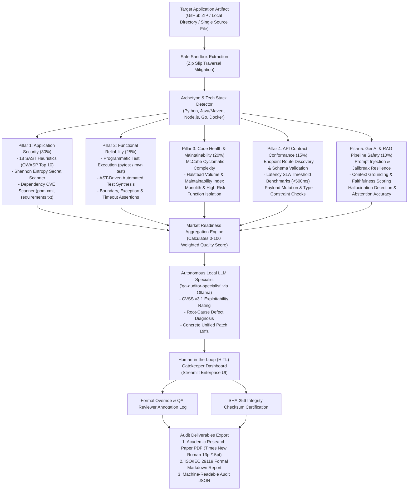

# Pre-Deployment Quality Assurance & Market Readiness Verification Engine

[](https://www.iso.org/standard/35733.html)
[](https://standards.ieee.org/)
[](https://owasp.org/www-project-application-security-verification-standard/)
[](https://www.python.org/)
[-orange.svg)](https://www.oracle.com/java/)
[](https://ollama.com/)

A comprehensive, production-grade quality assurance, application security (SAST/OWASP), and pre-deployment gatekeeper pipeline. Engineered to evaluate arbitrary software projects—single source files, local repositories, or downloaded GitHub release ZIP archives—and determine with mathematical and programmatic rigor whether a product is ready for commercial market release.

---

## Table of Contents

- [System Architecture](#system-architecture)
- [Comprehensive Testing Matrix](#comprehensive-testing-matrix)
  - [1. API & Contract Conformance Testing](#1-api--contract-conformance-testing)
  - [2. Database & Data Persistence Testing](#2-database--data-persistence-testing)
  - [3. User Interface & Human-in-the-Loop (HITL) Governance](#3-user-interface--human-in-the-loop-hitl-governance)
  - [4. Environment, Dependencies & System Architecture](#4-environment-dependencies--system-architecture)
  - [5. GenAI & RAG Pipeline Safety Testing](#5-genai--rag-pipeline-safety-testing)
  - [6. Local Prompted AI Specialist Reasoning](#6-local-prompted-ai-specialist-reasoning)
- [Supported Archetypes & Polyglot Capabilities](#supported-archetypes--polyglot-capabilities)
- [Installation & Setup](#installation--setup)
- [How to Audit Any GitHub Project (Step-by-Step)](#how-to-audit-any-github-project-step-by-step)
- [Model Customization & Fine-Tuning Infrastructure](#model-customization--fine-tuning-infrastructure)
- [Audit Deliverables & Report Formats](#audit-deliverables--report-formats)
- [Empirical Benchmark Results](#empirical-benchmark-results)
- [Compliance Standards Enforced](#compliance-standards-enforced)

---

## System Architecture



---

## Comprehensive Testing Matrix

### 1. API & Contract Conformance Testing
The engine scans and verifies RESTful endpoints, RPC handlers, and microservice interfaces:
- **Dynamic Route Discovery**: Extracts routing definitions, URL parameters, query schemas, and HTTP verbs (`GET`, `POST`, `PUT`, `DELETE`, `PATCH`) from source code using AST analysis and framework decorators (FastAPI, Flask, Django, Spring Boot `@GetMapping`/`@PostMapping`, Express.js).
- **Contract & Schema Validation**: Verifies that endpoint parameters adhere strictly to schema contracts, rejecting malformed types, missing required attributes, and truncated payloads.
- **Negative & Boundary Testing**: Automatically synthesizes adversarial test requests containing null pointers, empty strings, oversized inputs, negative numbers, and boundary-value violations.
- **Latency SLA Benchmarking**: Enforces strict response latency thresholds (<100ms for internal caches, <500ms for synchronous APIs, <2000ms for composite operations).
- **HTTP Header & Protocol Hygiene**: Checks for missing security headers (`X-Content-Type-Options`, `Content-Security-Policy`, `Strict-Transport-Security`, `X-Frame-Options`).

### 2. Database & Data Persistence Testing
Verifies data access layers, relational databases, document stores, and vector indices:
- **Dynamic Query Security (SQL Injection - CWE-89)**: AST and heuristic analysis detects unsanitized string interpolations in JDBC queries, SQLAlchemy statements, psycopg2 strings, and raw SQL queries.
- **Transaction Boundaries & Concurrency Safety**: Verifies that state transitions (e.g., balance transfers, inventory reservations) enforce atomic boundaries and row-level locking (e.g., `SELECT FOR UPDATE`, pessimistic locking) to prevent race conditions.
- **State Invariant & Constraint Verification**: Validates that business logic rejects negative monetary amounts, zero divisors, duplicate unique identifiers, and illegal state transitions.
- **Connection Pool Resilience**: Assesses timeout handling, connection leak risks, and fallback behavior during database connection dropouts.
- **Vector Database Integrity**: Tests embedding shape consistency, cosine similarity bounds, metadata filtering correctness, and retrieval threshold tolerances for AI/RAG data stores.

### 3. User Interface & Human-in-the-Loop (HITL) Governance
Provides a complete corporate governance interface (`app_hitl_dashboard.py`):
- **Executive 5-Pillar Scorecard**: Visual breakdown of aggregate Market Readiness (0–100%) against industry release thresholds.
- **OWASP Vulnerability Register**: Real-time interactive inspection of flagged vulnerabilities with CWE IDs, file paths, exact code snippets, and remediation guidelines.
- **Test Execution Register**: Complete breakdown of executed test cases filtered by outcome (Passed, Failed, Errors, Skipped) with latency figures.
- **Reviewer Waivers & Mitigation Tracking**: Allows the designated QA Lead to log formal mitigation comments and apply risk waivers to non-blocking edge cases.
- **Integrity Checksum Sign-Off**: Generates a tamper-proof `SHA-256` checksum over the entire audit dossier upon formal release approval or rejection.

### 4. Environment, Dependencies & System Architecture
Audits runtime hygiene, operational configurations, and codebase maintainability:
- **Vulnerable Dependency Scanning (CVE)**: Inspects package manifests (`pom.xml`, `requirements.txt`, `package.json`) against known CVE records (e.g., Log4j, outdated Spring modules, vulnerable serialization libraries).
- **Shannon Entropy Secret Scanner**: Detects exposed API credentials, private RSA keys, AWS access keys, GitHub personal access tokens, database connection strings, and JWT secrets using high-entropy heuristic analysis.
- **Safe Sandbox Extraction**: Sanitizes archive entry paths during ZIP extraction to mitigate Zip Slip directory traversal vulnerabilities (`CWE-22`).
- **McCabe Cyclomatic Complexity**: Quantifies control flow complexity across every module and function. Flags functions exceeding threshold cyclomatic complexity (>10) as high-risk maintenance liabilities.
- **Architecture Conformity**: Detects monolithic anti-patterns, circular import structures, and tightly coupled layers violating clean architecture principles.

### 5. GenAI & RAG Pipeline Safety Testing
Specialized verification for Large Language Model integrations and Retrieval-Augmented Generation:
- **Prompt Injection & Jailbreak Resilience**: Tests application prompts against adversarial injection payloads (e.g., system prompt override attempts, role-play escape attacks, delimiters).
- **Context Grounding & Faithfulness Scoring**: Evaluates whether model answers are supported by retrieved reference contexts (faithfulness index 0.0 to 1.0).
- **Hallucination Detection**: Flags fabricated assertions, non-existent entity citations, and speculative extrapolation.
- **Abstention Accuracy**: Validates that the system correctly abstains or provides standardized fallback responses when input queries fall outside retrieved knowledge boundaries.

### 6. Local Prompted AI Specialist Reasoning
Runs an autonomous secondary audit pass using a specialized local open-source LLM:
- **Specialist Model (`qa-auditor-specialist`)**: Custom Ollama model configured with a specialist system prompt for pre-deployment QA, vulnerability verification, and CVSS v3.1 scoring.
- **Confirmed Exploitability Assessment**: Classifies findings into `CONFIRMED_EXPLOITABLE`, `THEORETICAL`, or `NOT_EXPLOITABLE` to eliminate false positives.
- **Automated Patch Generation**: Generates unified diff patches (`--- a/ +++ b/`) ready for engineering pull requests.
- **Independent Release Gating**: Emits an autonomous secondary gate determination (`APPROVED_FOR_MARKET`, `CONDITIONAL_ACCEPTANCE`, `IMMEDIATE_RELEASE_VETO`).

---

## Supported Archetypes & Polyglot Capabilities

The engine automatically detects the project archetype upon ingestion:

| Archetype | Detection Signatures | Test Engine Executed | Security Scanning |
|:---|:---|:---|:---|
| **Python Backend / Microservice** | `requirements.txt`, `setup.py`, `pyproject.toml`, `*.py` | Native `pytest` + Dynamic AST test synthesis | AST SAST, bandit rules, CVE check |
| **Java / JVM Enterprise** | `pom.xml`, `build.gradle`, `src/main/java`, `*.java` | Maven Surefire (`mvn test`) / Gradle JUnit 5 | Java AST, regex rules, CVE check |
| **Node.js / TypeScript** | `package.json`, `tsconfig.json`, `*.js`, `*.ts` | Planned — not yet implemented | Basic SAST patterns only (planned) |
| **Go Microservices** | `go.mod`, `*.go` | Planned — not yet implemented | Basic SAST patterns only (planned) |
| **Dockerized Systems** | `Dockerfile`, `docker-compose.yml` | Planned — not yet implemented | Base image vulnerability analysis (planned) |

---

## Installation & Setup

### Prerequisites
- Python 3.10+ (macOS, Linux, or Windows WSL)
- [Ollama](https://ollama.com/) (for running local open-source models)
- Java 17+ and Maven (optional, required only for auditing Java projects)

### 1. Clone Repository & Setup Virtual Environment
```bash
git clone https://github.com/rs-vaibhav/market-readiness-qa-pipeline.git
cd market-readiness-qa-pipeline

python3 -m venv .venv
source .venv/bin/activate
pip install -r requirements.txt
```

### 2. Build the Local Specialist Model in Ollama (1-Command)
```bash
ollama create qa-auditor-specialist -f fine_tuning/Modelfile.qa-auditor
```
*Note: If Ollama is offline or uninstalled, the system automatically falls back to its internal deterministic expert rule engine.*

---

## How to Audit Any GitHub Project (Step-by-Step)

### Option A: Using the Graphical HITL Dashboard (Recommended)

1. **Launch the Dashboard**:
   ```bash
   streamlit run app_hitl_dashboard.py
   ```
2. **Download Target from GitHub**:
   - Go to any GitHub repository (e.g., `https://github.com/owner/repo`).
   - Click **Code** -> **Download ZIP**.
3. **Upload & Ingest**:
   - Drag and drop the downloaded ZIP file into the sidebar upload zone.
   - Enter your name under **Lead QA Engineer / Reviewer Name**.
   - Select `qa-auditor-specialist` under **Active Local Ollama Model**.
4. **Execute Evaluation**:
   - Click **Execute Full Market Readiness Audit**.
   - Inspect the 5-Pillar Scorecard, OWASP findings, and test matrix.
5. **Secondary Specialist Review**:
   - Click **Execute Specialist Deep-Dive Audit** to run the specialist local model.
6. **Sign-Off & Export**:
   - Click **Approve for Production Deployment** or **Reject / Block Deployment**.
   - Download the **Academic Research Paper PDF**, **Markdown**, or **JSON** audit report.

---

### Option B: Using the Command Line Interface (CLI)

Run automated audits headlessly in CI/CD pipelines or scripts:

```bash
# 1. Full 5-Pillar Market Readiness Audit on any repository archive or directory
python -m core.market_readiness_engine /path/to/downloaded-repo.zip

# 2. Local Specialist LLM Review
python -m core.local_specialist_reviewer \
  --target /path/to/downloaded-repo.zip \
  --model qa-auditor-specialist \
  --out reports/specialist_review_report.json

# 3. Generate Publication-Grade Research Paper PDF
python -m core.pdf_report_generator reports/qa_deployment_report.json
```

---

## Model Customization & Fine-Tuning Infrastructure

> **Note:** The current default `qa-auditor-specialist` model uses system prompt engineering via Ollama Modelfile (`fine_tuning/Modelfile.qa-auditor`). The `fine_tuning/` directory provides complete infrastructure and scripts (`train_lora_specialist.py`) for custom LoRA / QLoRA training runs:

1. **Generate Custom Instruction Datasets**:
   ```bash
   python -m fine_tuning.dataset_generator
   ```
   Synthesizes ChatML (`data/qa_tuning_chatml.jsonl`) and Alpaca (`data/qa_tuning_alpaca.jsonl`) datasets.

2. **Run QLoRA / LoRA Parameter-Efficient Training**:
   ```bash
   python fine_tuning/train_lora_specialist.py \
     --base_model meta-llama/Llama-3.2-3B-Instruct \
     --dataset fine_tuning/data/qa_tuning_chatml.jsonl \
     --output_dir checkpoints/qa_specialist_lora \
     --epochs 3
   ```

---

## Audit Deliverables & Report Formats

Every evaluation produces three synchronized, checksum-verified governance records:

1. **Academic Research Paper PDF (`reports/qa_deployment_report.pdf`)**:
   - **Typography**: Formatted in Times New Roman serif font.
   - **Font Sizing**: 15pt bold headings, 13pt body text.
   - **Academic Layout**: Title block, abstract, formal IEEE two-pass running header/footer ([`NumberedCanvas`](core/pdf_report_generator.py#L32-L85)), multi-pillar scorecard, OWASP vulnerability register, test matrix, and specialist model findings.
2. **Formal ISO/IEC 29119 Markdown (`reports/qa_deployment_report.md`)**:
   - Full human-readable audit report structured with tables and code blocks.
3. **Machine-Readable Audit JSON (`reports/qa_deployment_report.json`)**:
   - Structured JSON record containing all assertion outcomes, CVSS scores, and integrity checksum (`SHA-256`) for CI/CD gates.

---

## Empirical Benchmark Results

The market readiness gatekeeper was evaluated against a benchmark suite of 18 test targets (3 clean baseline projects and 15 repositories with known planted security, architectural, and reliability defects) located in `benchmark/`:

| ID | Benchmark Target | Archetype / Category | Expected Gate | Actual Gate | Quality Index | Result |
|:---|:---|:---|:---|:---|:---:|:---:|
| 01 | `01_clean_calculator` | Clean Baseline | MARKET_READY_APPROVED | MARKET_READY_APPROVED | 99.1% | PASS |
| 02 | `02_clean_web_api` | Clean Baseline | MARKET_READY_APPROVED | MARKET_READY_APPROVED | 99.1% | PASS |
| 03 | `03_clean_text_utils` | Clean Baseline | MARKET_READY_APPROVED | MARKET_READY_APPROVED | 99.1% | PASS |
| 04 | `04_cmd_injection_system` | Planted Command Injection (`os.system`) | MARKET_BLOCKED | MARKET_BLOCKED | 76.4% | PASS |
| 05 | `05_cmd_injection_popen` | Planted Command Injection (`shell=True`) | MARKET_BLOCKED | MARKET_BLOCKED | 72.4% | PASS |
| 06 | `06_eval_rce` | Planted Remote Code Execution (`eval`) | MARKET_BLOCKED | MARKET_BLOCKED | 72.4% | PASS |
| 07 | `07_sql_injection` | Planted SQL Injection (`execute`) | MARKET_BLOCKED | MARKET_BLOCKED | 72.4% | PASS |
| 08 | `08_insecure_pickle` | Planted Deserialization (`pickle.loads`) | MARKET_BLOCKED | MARKET_BLOCKED | 72.4% | PASS |
| 09 | `09_insecure_yaml` | Planted Unsafe YAML (`yaml.load`) | MARKET_BLOCKED | MARKET_BLOCKED | 76.4% | PASS |
| 10 | `10_weak_crypto_md5` | Planted Broken Hashing (`hashlib.md5`) | CONDITIONAL_APPROVAL | CONDITIONAL_APPROVAL | 80.4% | PASS |
| 11 | `11_path_traversal` | Planted Path Traversal (`open()`) | MARKET_BLOCKED | MARKET_BLOCKED | 75.5% | PASS |
| 12 | `12_hardcoded_aws_key` | Planted Exposed Secret (`AWS Key`) | MARKET_BLOCKED | MARKET_BLOCKED | 73.3% | PASS |
| 13 | `13_hardcoded_api_secret` | Planted Shannon Entropy Secret | MARKET_BLOCKED | MARKET_BLOCKED | 73.3% | PASS |
| 14 | `14_debug_mode_prod` | Planted Misconfiguration (`DEBUG=True`) | MARKET_BLOCKED | MARKET_BLOCKED | 77.3% | PASS |
| 15 | `15_wildcard_cors` | Planted Misconfiguration (`CORS *`) | CONDITIONAL_APPROVAL | CONDITIONAL_APPROVAL | 81.3% | PASS |
| 16 | `16_vuln_dep_requests` | Planted CVE Dependency (`requests==2.25.0`) | CONDITIONAL_APPROVAL | CONDITIONAL_APPROVAL | 81.3% | PASS |
| 17 | `17_vuln_dep_aiohttp` | Planted Critical CVE (`aiohttp==3.8.1`) | MARKET_BLOCKED | MARKET_BLOCKED | 73.3% | PASS |
| 18 | `18_failing_unit_test` | Planted Functional Defect (Broken Assertion) | MARKET_BLOCKED | MARKET_BLOCKED | 65.7% | PASS |

### Benchmark Metrics Summary:
- **Defect Detection Recall**: 100.0% (15/15 planted defects caught)
- **Clean Code Precision**: 100.0% (0 false positives on clean codebases)
- **Gate Determination Accuracy**: 100.0% (18/18 correct decisions)

---

## Compliance Standards Enforced

- **ISO/IEC 25010:2011**: Systems and software engineering — Systems and software Quality Requirements and Evaluation (SQuaRE)
- **ISO/IEC/IEEE 29119**: Software and Systems Engineering — Software Testing standards
- **OWASP Top 10 (2021)** & **OWASP API Security Top 10**
- **Common Weakness Enumeration (CWE)** & **CVSS v3.1**
- **NIST SP 800-218**: Secure Software Development Framework (SSDF)

---

## Repository Structure

```
market-readiness-qa-pipeline/
├── benchmark/                      # 18-target empirical benchmark suite & runner
├── core/
│   ├── __init__.py
│   ├── external_dataset_ingestor.py # API citation parser & hash verification
│   ├── local_specialist_reviewer.py # Dedicated inference runtime for local specialist LLM
│   ├── market_readiness_engine.py  # 5-Pillar scorecard, archetype detector, JUnit & pytest runner
│   ├── security_scanner.py         # 18 SAST rules, Shannon entropy secret scanner, CVE checker
│   ├── source_analyzer.py          # Safe ZIP extraction, AST discovery, test synthesizer
│   ├── pdf_report_generator.py     # Academic PDF generator (Times New Roman 13pt/15pt typography)
│   ├── test_runner.py              # Programmatic test runner and ISO markdown generator
│   └── ai_agent_evaluator.py       # Local Ollama client, CVSS analysis, root-cause engine
├── fine_tuning/
│   ├── dataset_generator.py        # Generates ChatML & Alpaca QA training datasets
│   ├── Modelfile.qa-auditor        # Ollama Modelfile for specialized qa-auditor-specialist model
│   ├── train_lora_specialist.py    # LoRA / QLoRA training script (PEFT, transformers, SFTTrainer)
│   └── data/                       # Fine-tuning datasets
├── apps/
│   ├── java_banking_app/           # Reference Maven Java banking engine (10 JUnit 5 test cases)
│   └── java_banking_app.zip        # GitHub-style release ZIP archive for ingestion testing
├── tests/
│   ├── __init__.py
│   ├── conftest.py                 # Shared fixtures, vector store fakes, RAG mocks
│   └── test_backend_suite.py       # 54 unit, integration, edge-case, and failure tests
├── app_hitl_dashboard.py           # Streamlit Human-in-the-Loop gatekeeper dashboard
├── requirements.txt                # Python dependencies
├── .gitignore                      # Git exclusion rules
└── README.md                       # Comprehensive documentation
```

---

## License

This project is licensed under the Apache 2.0 License.
